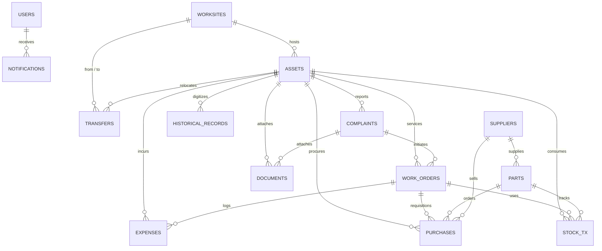

# NIC FleetHub - SQLite Database Schema Documentation

This document describes the schema design, tables, relationships, and indexes of the primary SQLite database (`backend/data/fleethub.db`).

---

## 1. Schema Overview

The database uses SQLite 3 with Write-Ahead Logging (`PRAGMA journal_mode = WAL`) and foreign key enforcement (`PRAGMA foreign_keys = ON`).

---

## 2. Table Definitions

### `users`
System administrative and operational accounts.
- `id` (INTEGER, Primary Key, Autoincrement)
- `username` (TEXT, Unique, Not Null)
- `name` (TEXT, Not Null)
- `role` (TEXT, Not Null) - e.g., `admin`, `super_admin`, `company_admin`, `transport`, `mechanical`, `workshop`, `mechanic`, `inventory`, `procurement`, `driver`, `management`, `viewer`
- `pw` (TEXT, Not Null) - Werkzeug salted scrypt/pbkdf2 hash
- `active` (INTEGER, Default 1)
- `preferred_lang` (TEXT, Default 'en') - `en`, `hi`, `ar`

### `worksites`
Operational yards, industrial complexes, and project sites in Kuwait.
- `id` (INTEGER, Primary Key, Autoincrement)
- `name` (TEXT, Unique, Not Null)
- `site_type` (TEXT, Default 'Project Site') - `Central Yard`, `Workshop & Yard`, `Production Complex`, `Project Site`
- `governorate` (TEXT, Default 'Capital') - Kuwait governorate
- `paci_no` (TEXT) - Kuwait Public Authority for Civil Information PACI building/plot ID
- `contact_person` (TEXT)
- `contact_phone` (TEXT)
- `active` (INTEGER, Default 1)

### `assets`
Fleet vehicles and heavy equipment records.
- `id` (INTEGER, Primary Key, Autoincrement)
- `code` (TEXT, Unique) - e.g., `AST-00001`
- `name` (TEXT, Not Null) - Asset description
- `category` (TEXT, Not Null) - e.g., `Dump Truck`, `Excavator`, `Mobile Crane`
- `equipment_type` (TEXT)
- `manufacturer` (TEXT)
- `brand` (TEXT)
- `model` (TEXT)
- `year` (INTEGER)
- `reg_no` (TEXT, Unique) - Kuwait vehicle plate number
- `plate_category` (TEXT, Default 'Commercial') - `Commercial`, `Private`, `Construction`, `Government`
- `vin` (TEXT, Unique) - 17-character chassis number
- `engine_no` (TEXT)
- `serial_no` (TEXT, Unique)
- `operator` (TEXT)
- `civil_id_operator` (TEXT) - 12-digit Kuwait Civil ID
- `department` (TEXT)
- `worksite_id` (INTEGER, Foreign Key -> `worksites.id`)
- `status` (TEXT, Default 'Active') - `Active`, `Under Repair`, `Out of Service`, `Retired`
- `purchase_date` (TEXT) - ISO date `YYYY-MM-DD`
- `purchase_cost` (REAL, Default 0) - Amount in KWD
- `insurance_company` (TEXT, Default 'Gulf Insurance Group (GIG)')
- `insurance_policy` (TEXT)
- `insurance_expiry` (TEXT) - ISO date `YYYY-MM-DD`
- `inspection_date` (TEXT) - Fahs Fanni inspection date
- `inspection_expiry` (TEXT) - Fahs Fanni technical inspection expiration
- `reg_expiry` (TEXT) - Ministry of Interior Traffic Dept (Daftar) expiry
- `ownership_type` (TEXT, Default 'Company Owned')
- `country` (TEXT, Default 'Kuwait')
- `governorate` (TEXT, Default 'Capital')
- `paci_no` (TEXT)
- `warranty_details` (TEXT)
- `remarks` (TEXT)
- `archived` (INTEGER, Default 0)
- `is_demo` (INTEGER, Default 0) - Isolation flag for demonstration records
- `created_at` (TEXT, Not Null)

### `complaints`
Operator defect reports and vehicle breakdowns.
- `id` (INTEGER, Primary Key, Autoincrement)
- `code` (TEXT, Unique) - e.g., `CMP-00001`
- `asset_id` (INTEGER, Foreign Key -> `assets.id`, Not Null)
- `driver` (TEXT)
- `location` (TEXT)
- `category` (TEXT)
- `description` (TEXT, Not Null) - English translated description
- `priority` (TEXT, Default 'Normal') - `Low`, `Normal`, `High`, `Critical`
- `voice_doc_id` (INTEGER, Foreign Key -> `documents.id`)
- `original_lang` (TEXT) - Original language: `ar`, `hi`, `en`
- `original_transcript` (TEXT) - Verbatim spoken voice note transcript
- `status` (TEXT, Default 'New') - `New`, `Approved`, `Rejected`, `Info Requested`, `Work Order Created`
- `decided_by` (TEXT)
- `decision_note` (TEXT)
- `decided_at` (TEXT)
- `created_by` (TEXT)
- `is_demo` (INTEGER, Default 0)
- `created_at` (TEXT, Not Null)

### `work_orders`
Workshop maintenance and repair orders.
- `id` (INTEGER, Primary Key, Autoincrement)
- `code` (TEXT, Unique) - e.g., `WO-00001`
- `asset_id` (INTEGER, Foreign Key -> `assets.id`, Not Null)
- `complaint_id` (INTEGER, Foreign Key -> `complaints.id`)
- `category` (TEXT)
- `description` (TEXT, Not Null)
- `priority` (TEXT, Default 'Normal')
- `status` (TEXT, Default 'Pending') - `Pending`, `Approved`, `Assigned`, `In Progress`, `Waiting for Spare Parts`, `Completed`, `Pending Inspection`, `Inspection Approved`, `Released`, `Cancelled`
- `assignee` (TEXT) - Workshop foreman or lead mechanic
- `findings` (TEXT) - Diagnostic remarks and mechanic logs
- `voice_doc_id` (INTEGER, Foreign Key -> `documents.id`)
- `original_lang` (TEXT)
- `original_transcript` (TEXT)
- `started_at` (TEXT)
- `completed_at` (TEXT)
- `released_at` (TEXT)
- `created_by` (TEXT)
- `is_demo` (INTEGER, Default 0)
- `created_at` (TEXT, Not Null)

### `parts`
Spare parts and workshop warehouse inventory catalog.
- `id` (INTEGER, Primary Key, Autoincrement)
- `stock_id` (TEXT, Unique, Not Null) - e.g., `STK-00001`
- `name` (TEXT, Not Null)
- `category` (TEXT)
- `manufacturer` (TEXT)
- `oem_no` (TEXT)
- `compat` (TEXT) - Equipment compatibility
- `unit` (TEXT, Default 'pcs')
- `qty` (REAL, Not Null, Default 0) - On-hand stock count
- `min_qty` (REAL, Not Null, Default 0) - Reorder threshold
- `unit_cost` (REAL, Not Null, Default 0) - Average moving cost in KWD
- `location` (TEXT) - Warehouse shelf or bay
- `supplier_id` (INTEGER, Foreign Key -> `suppliers.id`)
- `is_demo` (INTEGER, Default 0)

### `stock_tx`
Immutable audit log of inventory stock movements.
- `id` (INTEGER, Primary Key, Autoincrement)
- `part_id` (INTEGER, Foreign Key -> `parts.id`, Not Null)
- `kind` (TEXT, Not Null) - `in`, `issue`, `return`, `adjust`
- `qty` (REAL, Not Null)
- `prev_qty` (REAL, Not Null)
- `new_qty` (REAL, Not Null)
- `asset_id` (INTEGER, Foreign Key -> `assets.id`)
- `wo_id` (INTEGER, Foreign Key -> `work_orders.id`)
- `unit_cost` (REAL)
- `by` (TEXT)
- `note` (TEXT)
- `is_demo` (INTEGER, Default 0)
- `at` (TEXT, Not Null)

### `purchases`
External spare parts procurement orders.
- `id` (INTEGER, Primary Key, Autoincrement)
- `code` (TEXT, Unique) - e.g., `PUR-00001`
- `asset_id` (INTEGER, Foreign Key -> `assets.id`)
- `wo_id` (INTEGER, Foreign Key -> `work_orders.id`)
- `part_id` (INTEGER, Foreign Key -> `parts.id`)
- `part_name` (TEXT, Not Null)
- `qty` (REAL, Not Null)
- `currency` (TEXT, Default 'KWD')
- `original_price` (REAL) - Price in foreign currency
- `exchange_rate` (REAL, Default 1.0)
- `est_price` (REAL) - Estimated unit price in KWD
- `unit_price` (REAL) - Actual final unit price in KWD
- `supplier` (TEXT)
- `supplier_id` (INTEGER, Foreign Key -> `suppliers.id`)
- `invoice_no` (TEXT)
- `to_stock` (INTEGER, Default 0) - 1 if restocking warehouse, 0 if direct repair issue
- `status` (TEXT, Default 'Requested') - `Requested`, `Approved`, `Purchased`, `Received`, `Rejected`
- `requested_by` (TEXT)
- `decided_by` (TEXT)
- `is_demo` (INTEGER, Default 0)
- `created_at` (TEXT, Not Null)
- `purchased_at` (TEXT)

### `expenses`
Financial maintenance expense ledger.
- `id` (INTEGER, Primary Key, Autoincrement)
- `asset_id` (INTEGER, Foreign Key -> `assets.id`, Not Null)
- `wo_id` (INTEGER, Foreign Key -> `work_orders.id`)
- `kind` (TEXT, Not Null) - `spare_part`, `external_purchase`, `external_labour`, `outsourced_service`, `towing`, `external_inspection`, `other_approved`
- `currency` (TEXT, Default 'KWD')
- `original_amount` (REAL)
- `exchange_rate` (REAL, Default 1.0)
- `amount` (REAL, Not Null) - Final converted amount in KWD (3 decimal places)
- `ref` (TEXT) - External reference or transaction token
- `note` (TEXT)
- `by` (TEXT)
- `is_demo` (INTEGER, Default 0)
- `at` (TEXT, Not Null)

### `documents`
Secure metadata registry for uploaded files and voice recordings.
- `id` (INTEGER, Primary Key, Autoincrement)
- `asset_id` (INTEGER, Foreign Key -> `assets.id`)
- `wo_id` (INTEGER, Foreign Key -> `work_orders.id`)
- `complaint_id` (INTEGER, Foreign Key -> `complaints.id`)
- `purchase_id` (INTEGER, Foreign Key -> `purchases.id`)
- `expense_id` (INTEGER, Foreign Key -> `expenses.id`)
- `historical_id` (INTEGER, Foreign Key -> `historical_records.id`)
- `kind` (TEXT) - `Document`, `Complaint photograph`, `Repair photograph`, `Purchase bill`, `Expense bill`, `Voice Note`, `Voice recording`
- `filename` (TEXT, Not Null) - Original filename
- `stored` (TEXT, Not Null) - Hashed file name on disk inside `backend/uploads/`
- `mime` (TEXT) - e.g., `application/pdf`, `image/png`, `audio/webm`, `audio/wav`
- `by` (TEXT)
- `is_demo` (INTEGER, Default 0)
- `at` (TEXT, Not Null)

### `suppliers`
Suppliers, equipment dealers, and spare parts vendors in Kuwait.
- `id` (INTEGER, Primary Key, Autoincrement)
- `code` (TEXT, Unique) - e.g., `SUP-0001`
- `name` (TEXT, Not Null)
- `contact_person` (TEXT)
- `phone` (TEXT)
- `email` (TEXT)
- `address` (TEXT)
- `tax_no` (TEXT)
- `categories` (TEXT)
- `notes` (TEXT)
- `active` (INTEGER, Default 1)
- `is_demo` (INTEGER, Default 0)
- `created_at` (TEXT, Not Null)

### `historical_records`
Digitized legacy maintenance and service records (3-year backlog).
- `id` (INTEGER, Primary Key, Autoincrement)
- `code` (TEXT, Unique) - e.g., `HST-00001`
- `asset_id` (INTEGER, Foreign Key -> `assets.id`, Not Null)
- `record_type` (TEXT, Not Null) - `service`, `repair`, `inspection`, `overhaul`, `parts_replacement`
- `record_date` (TEXT, Not Null) - ISO date `YYYY-MM-DD`
- `title` (TEXT, Not Null)
- `description` (TEXT)
- `work_order_ref` (TEXT)
- `invoice_no` (TEXT)
- `supplier_vendor` (TEXT)
- `performed_by` (TEXT)
- `parts_replaced` (TEXT)
- `cost` (REAL, Default 0) - Cost in KWD
- `verified` (INTEGER, Default 1)
- `missing_info_notes` (TEXT)
- `created_by` (TEXT, Not Null)
- `is_demo` (INTEGER, Default 0)
- `created_at` (TEXT, Not Null)

### `transfers`
Asset relocation tracking between Kuwait worksites.
- `id` (INTEGER, Primary Key, Autoincrement)
- `asset_id` (INTEGER, Foreign Key -> `assets.id`, Not Null)
- `from_site` (TEXT)
- `to_site` (TEXT)
- `from_worksite_id` (INTEGER, Foreign Key -> `worksites.id`)
- `to_worksite_id` (INTEGER, Foreign Key -> `worksites.id`)
- `transfer_reason` (TEXT)
- `meter_reading` (REAL, Default 0)
- `transport_details` (TEXT)
- `by` (TEXT)
- `is_demo` (INTEGER, Default 0)
- `at` (TEXT, Not Null)

### `notifications`
Role-targeted and user-targeted in-app notifications.
- `id` (INTEGER, Primary Key, Autoincrement)
- `user_id` (INTEGER, Foreign Key -> `users.id`)
- `target_role` (TEXT)
- `title` (TEXT, Not Null)
- `message` (TEXT, Not Null)
- `kind` (TEXT, Not Null) - `system`, `complaint`, `wo`, `purchase`, `low_stock`, `compliance`, `inquiry`
- `link` (TEXT)
- `read` (INTEGER, Default 0)
- `is_demo` (INTEGER, Default 0)
- `created_at` (TEXT, Not Null)

### `audit`
Tamper-resistant audit log of all system actions.
- `id` (INTEGER, Primary Key, Autoincrement)
- `user` (TEXT)
- `action` (TEXT)
- `entity` (TEXT)
- `entity_id` (TEXT)
- `detail` (TEXT)
- `is_demo` (INTEGER, Default 0)
- `at` (TEXT, Not Null)

### `exchange_rates`
Foreign exchange rates pegged against Kuwaiti Dinar (KWD).
- `id` (INTEGER, Primary Key, Autoincrement)
- `currency` (TEXT, Unique, Not Null) - e.g., `USD`, `EUR`, `GBP`, `AED`, `SAR`, `INR`
- `rate_to_kwd` (REAL, Not Null) - Rate multiplier to convert 1 foreign unit to KWD
- `rate_from_kwd` (REAL, Default 0)
- `is_manual` (INTEGER, Default 0)
- `is_auto` (INTEGER, Default 1)
- `source` (TEXT)
- `last_updated` (TEXT, Not Null)
